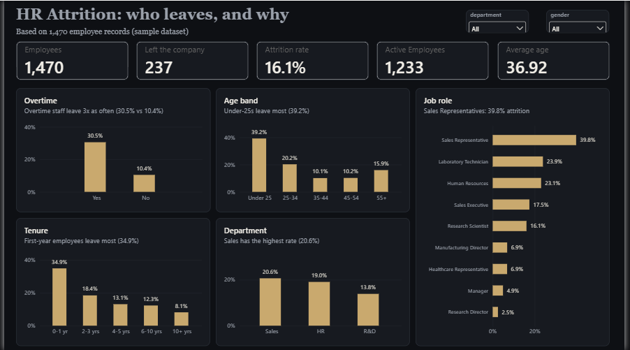
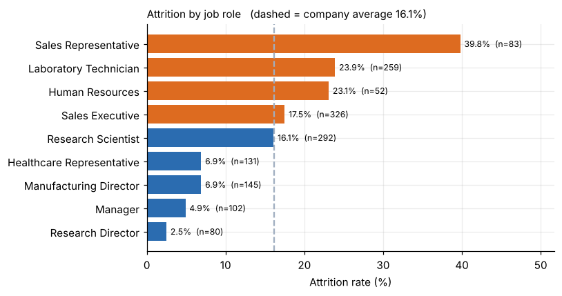
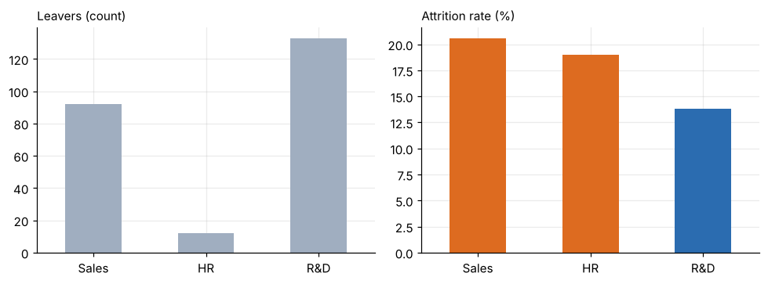

# HR Attrition Analytics

Which employees leave, and what do they have in common? An end-to-end analysis of 1,470 employee records using **SQL, Python, Excel** and Power BI.

> **Data note:** the dataset is the public *IBM HR Analytics Employee Attrition & Performance* sample (Kaggle). The employees are fictional, so results describe this sample and are not claims about a real company.

## Key findings

| Metric | Value |
|---|---:|
| Employees | 1,470 |
| Left the company | 237 |
| Attrition rate | **16.12%** |
| Active employees | 1,233 |
| Average age | 36.92 |

1. **Overtime is the strongest signal.** 30.5% attrition with overtime vs 10.4% without. Single employees working overtime: 49.6%.
2. **Early career, early tenure.** Under-25s leave at 39.2%, first-year employees at 34.9%.
3. **Role matters more than department.** Sales Representatives 39.8% vs Research Directors 2.5%. R&D has the most leavers (133) but the lowest rate (13.8%), so counts alone mislead.
4. **Pay.** Lowest income quartile 29.3% vs about 10% in the top two quartiles.
5. **A small high-risk group** (under 35, single, overtime): 68 employees, 66.2% left. Small sample, so a lead to investigate rather than a rule.

## Power BI dashboard



One-page interactive report built from `data/hr_attrition_clean.csv`: 5 KPI cards, 5 charts (overtime, age band, tenure, department, job role) and department / gender slicers. Every chart plots the attrition *rate* rather than the headcount, and titles state the finding. DAX measures (`Employees`, `Attrition Count`, `Attrition Rate`, `Active Employees`, `Avg Age`) and calculated columns (`Age Band`, `Tenure Band`) are listed in `powerbi/POWER_BI_BUILD_GUIDE.md`. Open `powerbi/HR_Attrition_Dashboard.pbix` in Power BI Desktop; if it asks for the data source, point it to `data/hr_attrition_clean.csv`.

## Python charts




## What is in this repo

```text
hr-attrition-analytics/
├── data/
│   ├── HR_Data_raw.xlsx            raw workbook (41 columns)
│   └── hr_attrition_clean.csv      cleaned data (32 columns, snake_case)
├── scripts/
│   ├── prepare_data.py             cleaning + SQLite build
│   ├── run_queries.py              runs every SQL query and prints results
│   └── build_excel.py              builds the Excel workbook
├── sql/analysis_queries.sql        10 queries: GROUP BY, CASE, CTE, RANK, NTILE
├── notebooks/hr_attrition_analysis.ipynb   executed notebook with charts
├── excel/HR_Attrition_Analysis.xlsx        formula-driven KPIs, segment tables, charts
├── images/                         dashboard screenshot + exported charts
└── powerbi/
    ├── HR_Attrition_Dashboard.pbix the finished report
    ├── Obsidian_Gold_Theme.json    custom theme (dark charcoal + gold)
    └── POWER_BI_BUILD_GUIDE.md     DAX measures and page design
```

## How the analysis was done

- **Cleaning (Python):** dropped 9 columns that carry no information (five constants, four spreadsheet helper columns), renamed columns to snake_case, checked for nulls and duplicates (none), and asserted the headline numbers.
- **SQL (SQLite):** KPIs, attrition rate by department / age band / overtime / job role / tenure, income quartiles with `NTILE`, role ranking with `RANK()`, and an overtime x marital-status segment with a CTE.
- **Python:** pandas + matplotlib. Every chart compares each group with the 16.1% company average and shows group size.
- **Power BI:** data model with 5 DAX measures and 4 calculated columns, a custom JSON theme, validated against the SQL results (1,470 / 237 / 16.1% / 1,233 / 36.92; Overtime 30.5% vs 10.4%) before any design work.
- **Excel:** 3,000+ live formulas (`COUNTIFS`, `AVERAGEIF`, nested `IF` for bands) and charts. Nothing is hard-coded, and the totals match the SQL and Python results.

## Run it

```bash
pip install -r requirements.txt
python scripts/prepare_data.py     # clean data + build data/hr.db
python scripts/run_queries.py      # run the SQL analysis
jupyter notebook notebooks/hr_attrition_analysis.ipynb
python scripts/build_excel.py      # rebuild the Excel workbook
```

## Limitations

- Descriptive analysis on a sample dataset. Rates show association, not cause.
- No prediction model was built.
- Some segments are small (e.g. HR department n=63, Human Resources education field n=27), so their rates move a lot with a few people.

## Tools

Python (pandas, matplotlib), SQL (SQLite), Microsoft Excel, Power BI
